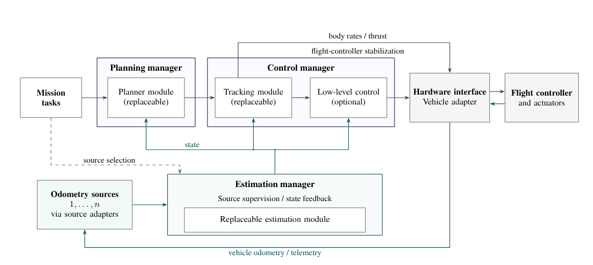

# LASER UAV System [LUS]

[![simulation-build-[px4]](https://github.com/LASER-Robotics/laser_uav_system/actions/workflows/simulation-build-%5Bpx4%5D.yml/badge.svg)](https://github.com/LASER-Robotics/laser_uav_system/actions/workflows/simulation-build-%5Bpx4%5D.yml)
[![real-build-[px4-ap]](https://github.com/LASER-Robotics/laser_uav_system/actions/workflows/real-build-%5Bpx4-ap%5D.yml/badge.svg)](https://github.com/LASER-Robotics/laser_uav_system/actions/workflows/real-build-%5Bpx4-ap%5D.yml)
[](https://opensource.org/licenses/BSD3) \
[![simulation-build-[ap]](https://github.com/LASER-Robotics/laser_uav_system/actions/workflows/simulation-build-%5Bap%5D.yml/badge.svg)](https://github.com/LASER-Robotics/laser_uav_system/actions/workflows/simulation-build-%5Bap%5D.yml)

The LASER UAV System (LUS) is an open-source ROS 2 framework for autonomous UAV flight. It brings state estimation, trajectory planning and flight control into one stack, with PX4 and ArduPilot interfaces and a Gazebo Classic simulation environment.

Use LUS to develop flight algorithms, test them in simulation and run the stack on a physical UAV. Its packages separate the flight pipeline into components that can be configured for different airframes and sensor setups.

This repository brings together the LUS packages and installation tools. [Gitman](.gitman.yml) manages their versions, stores the checkouts in `.gitman/` and links them into `ros_packages/`.

## System overview

The flight pipeline connects sensor measurements to vehicle commands:

- Perception and state estimation provide odometry from visual, LiDAR, inertial and GNSS measurements.
- Planning generates trajectories with MINCO, PMM or SUPER.
- Mapping maintains local obstacle maps with ROG-Map.
- Control handles takeoff, hold and landing, and tracks trajectories with NMPC and INDI.
- The hardware API exchanges commands and telemetry with PX4 or ArduPilot.
- Simulation provides airframes, sensors, worlds and launch sessions in Gazebo Classic.

### Architecture



## Getting started

The supplied installation targets Ubuntu 22.04 (Jammy) and ROS 2 Humble. Start with Git installed; the installer sets up ROS, system dependencies and the selected LUS packages. A fresh Ubuntu installation is recommended for the full environment setup.

### Install LUS

```bash
mkdir -p ~/git
cd ~/git
git clone https://github.com/LASER-Robotics/laser_uav_system.git
cd laser_uav_system
./install.sh
```

The installer asks whether you are configuring a real UAV or simulation. For simulation, choose PX4, ArduPilot (`ap`) or both. For real hardware, it also asks for the UAV name and airframe type and offers sensor SDK installation.

The ROS workspace is created at `~/laser_uav_system_ws`, with package links under `src/`. The installer also builds the required firmware and communication tools for the selected setup and configures the shell environment.

The [LASER Linux setup](https://github.com/Augusto-Viniciuss/linux-setup) is an optional way to prepare the desktop environment before installing LUS. Run its installer first if you want that setup.

### Environment

| Variable | Meaning |
| --- | --- |
| `REAL_UAV` | `false` for simulation or `true` for physical hardware. Launch files use it to select clock and hardware behavior. |
| `UAV_NAME` | Vehicle namespace, such as `uav1`. |
| `UAV_TYPE` | Airframe configuration, such as `x500` or `lr7pro`. |

Use the same namespace, clock and airframe configuration across the nodes for a vehicle. Check the package README before overriding a launch argument, since defaults differ between packages.

## Run a simulation

Simulation sessions are in `laser_uav_simulation/tmux/`. To start the PX4 simulation:

```bash
cd ~/laser_uav_system_ws/src/laser_uav_simulation/tmux/one_drone_px4
./start.sh
```

The session opens the simulator, spawns the vehicle and starts the configured flight stack. Its `configs/` directory holds the spawn, planner and topic-monitor settings. Use the [simulation README](https://github.com/LASER-Robotics/laser_uav_simulation) for individual launch commands and sensor options.

The lr7pro is one of the airframes used with LUS:

https://github.com/user-attachments/assets/6dfdd26c-1327-4a3c-a88e-73f5a55d394f

## Flight validation

The LUS control stack has been tested with NMPC and INDI in simulation and on physical UAVs, using visual-inertial odometry, LiDAR-inertial odometry and GNSS-based state estimation.

The following flight uses an x500 with LiDAR-inertial odometry and NMPC + INDI:

https://github.com/user-attachments/assets/92809e07-3467-4af6-8510-690d2e050b79

Airframe parameters include mass, inertia, motor allocation and thrust calibration. Configure them for your vehicle before using the stack on hardware.

## Packages

| Repository | Role in LUS |
| --- | --- |
| [laser_uav_managers](https://github.com/LASER-Robotics/laser_uav_managers) | Runs the control, planning and estimation nodes. |
| [laser_uav_controllers](https://github.com/LASER-Robotics/laser_uav_controllers) | NMPC and INDI control libraries and NMPC tuning. |
| [laser_uav_planners](https://github.com/LASER-Robotics/laser_uav_planners) | Collects the PMM and SUPER backends; MINCO uses the solver exported by SUPER. |
| [laser_uav_mappings](https://github.com/LASER-Robotics/laser_uav_mappings) | Provides ROG-Map for local occupancy maps, obstacle inflation and distance fields used by SUPER. |
| [laser_uav_estimators](https://github.com/LASER-Robotics/laser_uav_estimators) | State-estimator libraries and sensor-noise tuning. |
| [laser_uav_lio-s](https://github.com/LASER-Robotics/laser_uav_lio-s) | FAST-LIO integration for LiDAR-inertial odometry. |
| [laser_uav_vio-s](https://github.com/LASER-Robotics/laser_uav_vio-s) | OpenVINS integration for visual-inertial odometry. |
| [laser_uav_imu_filter](https://github.com/LASER-Robotics/laser_uav_imu_filter) | Conditions IMU streams with IIR and notch filters. |
| [laser_uav_hw_api](https://github.com/LASER-Robotics/laser_uav_hw_api) | Converts PX4 and ArduPilot telemetry and commands to LUS interfaces. |
| [laser_uav_tui](https://github.com/LASER-Robotics/laser_uav_tui) | Terminal dashboard for telemetry and flight commands. |
| [laser_msgs](https://github.com/LASER-Robotics/laser_msgs) | Shared ROS message and service definitions. |
| [laser_uav_lib](https://github.com/LASER-Robotics/laser_uav_lib) | Shared C++ filters, attitude conversions and other utilities. |
| [laser_uav_simulation](https://github.com/LASER-Robotics/laser_uav_simulation) | Gazebo launch files, airframes and simulation sessions. |
| [laser_gazebo_resources](https://github.com/LASER-Robotics/laser_gazebo_resources) | Gazebo sensor and motor plugins, models and worlds. |
| [px4_firmware](https://github.com/LASER-Robotics/px4_firmware-ROS2-) | PX4 firmware and SITL implementation used by the PX4 setup. |
| [px4_msgs](https://github.com/LASER-Robotics/px4_msgs) | ROS interfaces matching the PX4 firmware. |
| [ap_firmware](https://github.com/LASER-Robotics/ap_firmware-ROS2-) | ArduPilot firmware with DDS support. |
| [micro_xrce_dds_agent](https://github.com/LASER-Robotics/Micro-XRCE-DDS-Agent) | Standalone bridge between XRCE-DDS clients and DDS. |
| [micro_ros_agent](https://github.com/LASER-Robotics/micro-ROS-Agent) | ROS 2 wrapper around the XRCE-DDS agent, used by the ArduPilot setup. |
| [micro_xrce_dds_gen](https://github.com/LASER-Robotics/Micro-XRCE-DDS-Gen) | Generates Micro CDR serialization code needed by the ArduPilot build. |
| [ardupilot_msgs](https://github.com/LASER-Robotics/ardupilot_msgs) | ROS interfaces for ArduPilot communication. |
| [laser_uav_drivers](https://github.com/LASER-Robotics/laser_uav_drivers) | Sensor drivers and SDK wrappers for physical UAVs. |
| [laser_uav_deployment](https://github.com/LASER-Robotics/laser_uav_deployment) | Deployment tools for onboard computers. |

## License

LUS is distributed under the [BSD 3-Clause license](LICENSE). Component repositories and bundled dependencies retain their own licenses.
